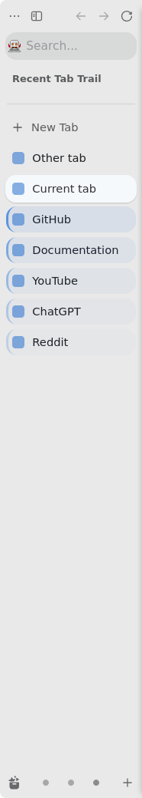
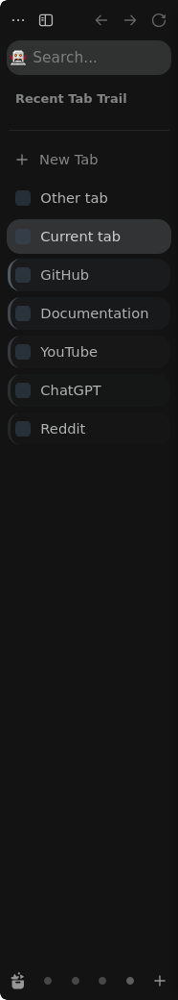
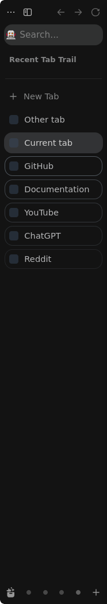
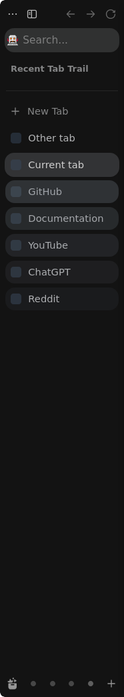

# Recent Tab Trail

I often have way too many tabs open, jump between them randomly, and lose track
of the ones I visited recently. I made this Zen mod to help me find my way back.

It highlights recently visited tabs in the sidebar. The most recent gets the
strongest highlight, and older visits fade. Tabs stay in place, and the selected
tab keeps its normal appearance.

Light and dark mode with the Purple color and Bar + tint style:

 

## What it does

- Shows up to 20 previously visited tabs (5 by default).
- Follows tab selection whether you use the mouse or keyboard.
- Works with workspaces, folders, pinned tabs, and Essentials.
- Keeps a separate trail in each window, including private windows.
- Saves only settings, with no browsing history stored or network requests.

## Installation

You'll need Zen Browser and [Sine 2.3.3 or later](https://github.com/sineorg/docs/blob/main/src/installation.md).

1. In **Sine Mods**, choose **Add your own locally from a GitHub repo** and enter:

   ```text
   https://github.com/evgen2571/zen-recent-tab-trail
   ```

2. In **Sine settings**, allow JavaScript from unofficial sources. This is
   required for the mod to run (`sine.allow-unsafe-js = true` in `about:config`).
3. Enable **Recent Tab Trail**.

For a local checkout or offline install, see [local installation](VERIFICATION.md#development--offline-installation).

## Settings

Open Recent Tab Trail's settings in Sine Mods. Changes apply immediately.

| Setting | Choices | Default |
| --- | --- | --- |
| Number of recent tabs | 1 to 20 | 5 |
| Workspace history | Current workspace, Global | Current workspace |
| Include pinned tabs / Essentials | Separate switches | Both on |
| Indicator style | Bar + tint, Bar only, Outline, Tint, Solid fill | Bar + tint |
| Color | Zen accent, Purple, Blue, Cyan, Green, Orange, Red, Pink, Custom | Zen accent |
| Custom color | CSS color; shown only with Custom | `#7c6cff` |
| Intensity | Subtle, Normal, Strong | Normal |

Custom colors can be hex, RGB, HSL, or another standalone CSS color. Invalid
colors fall back to Zen's accent. Solid fill stays translucent even at Strong
intensity.

Outline and Solid fill with Purple in dark mode:

 

## Compatibility and limitations

Tested with Zen 1.23b and Sine 2.3.3 on Linux. Windows, macOS, third-party themes,
and combinations of dragging, audio, and container controls still need manual
checks. Firefox compatibility hasn't been tested.

- Restored history depends on Zen's session data, which can't always distinguish
  old background tabs or recover the order of visits with equal timestamps.
- Hidden tabs and collapsed folder members don't take up trail slots. Global
  workspace history can leave gaps in the visible trail when recent tabs are in
  another workspace.
- Very light or dark custom colors can be hard to see against a matching sidebar.

## Development

There's no build step or runtime dependency. With Node.js 22+, run:

```sh
node --check recent-tab-trail.uc.js
node --check tools/install-local.mjs
node --test tests/*.test.cjs
```

GitHub Actions runs the same checks on Linux with Node 24. The tests use browser
fixtures, so rendering still needs a check in Zen. See [VERIFICATION.md](VERIFICATION.md)
for local installation, browser checks, and a few notes on Zen's internals.

## License

[MIT](LICENSE).
